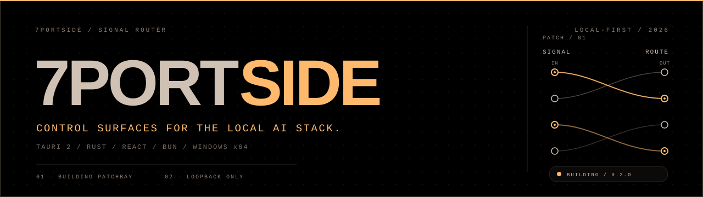
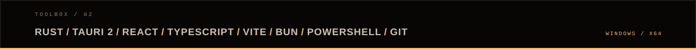

  

  LOCAL-FIRST TOOLS · WINDOWS x64 · OPENAI + ANTHROPIC

 

  <b>I build small, visible control surfaces for runtimes that usually live in a terminal.</b> 
  Currently building <a href="https://github.com/7portside/patchbay"><b>Patchbay</b></a> — a Windows desktop shell for local OpenAI- and Anthropic-compatible proxy engines.

 

  
  &nbsp;&nbsp;
  

---

## Now

| Signal | Detail |
| :--- | :--- |
| **Building** | [Patchbay](https://github.com/7portside/patchbay) — a control surface for the local AI stack |
| **Latest** | [v0.2.0](https://github.com/7portside/patchbay/releases/tag/v0.2.0) — per-user Windows x64 installer |
| **Stack** | Tauri 2 · Rust · React · TypeScript · Bun |
| **Focus** | Local-first tools, observable runtimes, precise interfaces |

## Patchbay

> The control room for the local AI stack.

Patchbay turns a background proxy into a supervised service you can see: start it, stop it, restart it, read its logs, watch request rate, inspect model health, change port and keys, and copy the endpoint into any coding agent.

- Supervised engine lifecycle with process-tree cleanup.
- Live request counters, latency, sparklines and recent activity.
- Model registry with health states, tests and default selection.
- Filterable logs, settings, diagnostics and a one-click endpoint copy.

  

  Patchbay 0.2.0 / Windows x64 / one real request through the local engine

  <a href="https://github.com/7portside/patchbay/releases/latest"><b>Download</b></a>
  &nbsp;·&nbsp;
  <a href="https://github.com/7portside/patchbay"><b>Source</b></a>
  &nbsp;·&nbsp;
  <a href="https://github.com/7portside/patchbay#readme"><b>Documentation</b></a>

## Toolbox

  

## Signal

- **Local by default.** Loopback only. No account, no cloud relay, no hidden backend.
- **Visible by design.** State, logs, latency and model health belong on the surface, not in a terminal.
- **Small surface.** One job, few controls, no dashboard theatre.

---

  7PORTSIDE / LOCAL-FIRST / 2026

